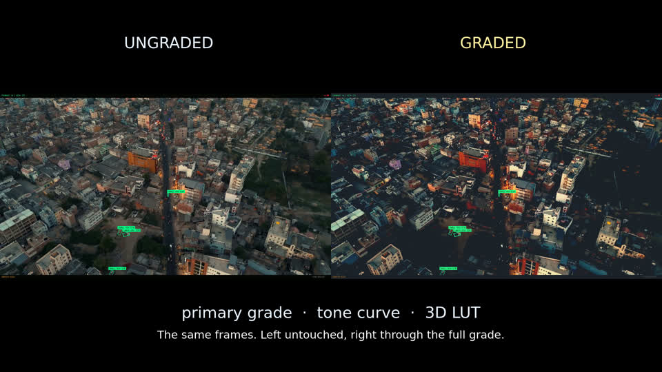
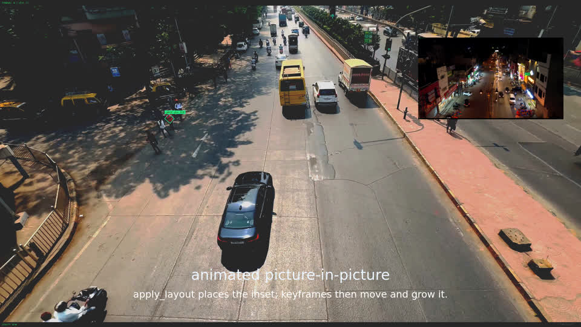
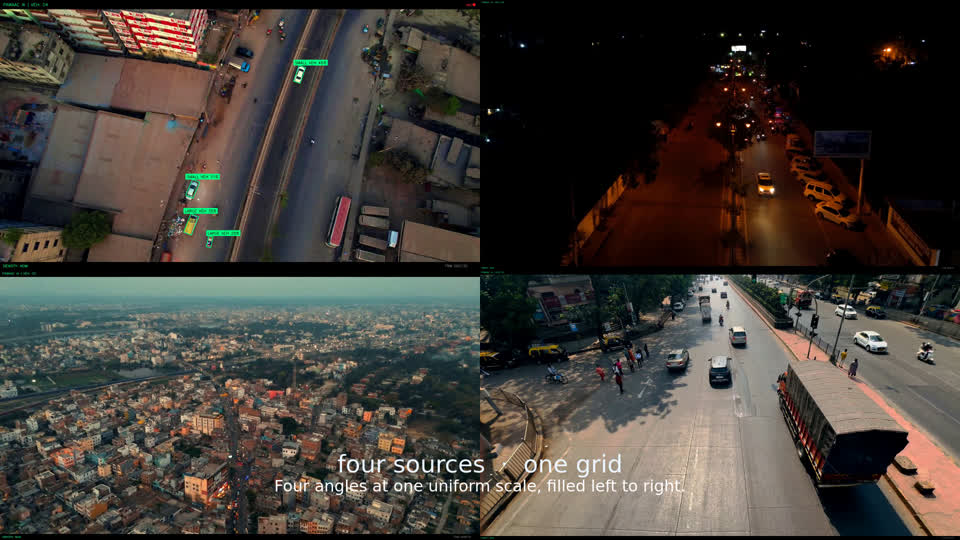

<div align="center">


# Palmier Pro for Linux

**A multi-track video editor for Linux that AI agents can drive.**

Every edit is an MCP tool, so Claude Code, Codex, Cursor and the built-in agent chat<br>
work on the same timeline you do. An independent C++20, Qt 6 and Vulkan port of
[Palmier Pro](https://github.com/palmier-io/palmier-pro).

[](https://github.com/Bhaveshmeghwal21/palmier-pro-linux/actions/workflows/ci.yml)
[](LICENSE)
[](https://en.cppreference.com/w/cpp/20)
[](https://www.qt.io/)
[](https://www.vulkan.org/)
[](docs/MCP_CLIENTS.md)
[](docs/BUILD.md)

[**Quick start**](#quick-start) ·
[**Connect an agent**](#connect-an-agent) ·
[**Features**](#features) ·
[**Documentation**](#documentation) ·
[**Roadmap**](#status-and-roadmap)

<br>


<sub>Cut entirely by an agent over MCP: 150 tool calls across 19 tools, zero failures,
exported to 1080p30 H.264 with NVENC on an NVIDIA L4.</sub>

</div>

## Highlights

- **Agents edit the real timeline.** Over 40 MCP tools cover import, cut, trim, ripple, layout,
  keyframes, grading, captions, undo/redo and export. The in-app agent chat calls the same tools,
  and a property test checks that both paths produce identical edits.
- **Colour tools you would expect from an NLE.** Primary grade, three colour wheels, per-channel
  tone curves, HSL-qualified secondary grades, 3D `.cube` LUTs, and histogram, waveform and
  vectorscope scopes.
- **GPU when you have one, CPU when you don't.** Vulkan compositing on NVIDIA, AMD and Intel,
  with a software renderer that a parity test holds to the same output. The editor runs on any
  machine, including a CI runner with no GPU.
- **Hardware encode.** NVENC, VAAPI and Quick Sync through FFmpeg, with automatic software
  fallback. NVENC is validated on a real NVIDIA L4.
- **Local by default.** The MCP server listens on `127.0.0.1` only, and remote access is opt-in
  with a token and TLS. Editing needs no network connection.
- **Thoroughly tested.** The suite holds more than 1900 GoogleTest and RapidCheck cases across
  90 test executables, and CI gates line coverage.

## Features

<table>
  <tr>
    <td width="33%"></td>
    <td width="33%"></td>
    <td width="33%"></td>
  </tr>
  <tr>
    <td align="center"><b>Grade</b><br><sub>Primary grade, tone curve and 3D LUT</sub></td>
    <td align="center"><b>Picture-in-picture</b><br><sub>Layout preset, then keyframed motion</sub></td>
    <td align="center"><b>Grid</b><br><sub>Four sources, independent grades</sub></td>
  </tr>
</table>

| Area | What you get |
|---|---|
| **Editing** | Up to 50 tracks; trim, split, move, reorder, ripple delete, ripple trim and close gap; timeline markers; undo and redo |
| **Motion** | Per-clip position, scale, rotation, flips and opacity; edge fades; keyframes with linear or smooth interpolation; clip speed; side-by-side, picture-in-picture and grid layouts |
| **Colour** | Lift, gamma and gain; three colour wheels; per-channel tone curves; qualifier-masked secondary grades; 3D LUTs; histogram, waveform and vectorscope |
| **Effects** | Brightness, contrast, blur, edge-preserving denoise, invert and crop; crossfade, fade, dip-to-colour, wipe and slide transitions |
| **Text and captions** | Styled text clips; caption cues you can edit and retime; burned-in captions and `.srt` sidecars |
| **Audio** | PipeWire and ALSA output, level meters, timeline waveforms, scrub audio, keyframed gain, per-track mute |
| **Export** | MP4, MOV, MKV and WebM; H.264, HEVC and VP9; up to 3840×2160 and 120 fps; hardware encode with software fallback |
| **Agents** | MCP server at `127.0.0.1:19789`, in-app agent chat, frame capture so an agent can check its own work, opt-in remote access |

## Quick start

There are no prebuilt packages yet, so build from source. On Ubuntu 24.04 or another Debian
derivative:

```bash
git clone https://github.com/Bhaveshmeghwal21/palmier-pro-linux.git
cd palmier-pro-linux

make deps     # Qt 6, FFmpeg, Vulkan and the vendor codec SDKs (uses sudo)
make build    # CMake + Ninja
make run      # launch the editor
```

`make test` runs the full suite headless under Xvfb. Run `make` on its own to list every
target.

<details>
<summary><b>With only Docker installed</b></summary>

```bash
docker compose run --rm test     # build and run the full suite
docker compose up editor         # launch the editor on your X display
docker compose run --rm shell    # a shell with the whole toolchain
```

The image is `ubuntu:24.04` pinned by digest and installs
[`packaging/apt-packages.txt`](packaging/apt-packages.txt), the same package list CI uses. A
[devcontainer](.devcontainer/devcontainer.json) reuses the same Dockerfile for VS Code and
Codespaces.

</details>

<details>
<summary><b>With CMake directly</b></summary>

```bash
cmake -S . -B build -G Ninja \
  -DCMAKE_BUILD_TYPE=RelWithDebInfo \
  -DPALMIER_BUILD_TESTS=ON \
  -DPALMIER_BUILD_UI=ON \
  -DPALMIER_ENABLE_VAAPI=ON \
  -DPALMIER_ENABLE_NVENC=ON \
  -DPALMIER_ENABLE_QSV=ON

cmake --build build
xvfb-run -a ctest --test-dir build --output-on-failure
./build/bin/palmier-pro
```

These are the flags CI uses. Other distributions, every `PALMIER_*` option and the minimum host
specification are in [`docs/BUILD.md`](docs/BUILD.md).

</details>

<details>
<summary><b>No GPU, no audio device, no display</b></summary>

All three are supported, and CI runs on a runner that has none of them.

- **No Vulkan device:** the status bar says so and compositing runs on the CPU.
- **No audio output:** the editor tries PipeWire, then ALSA, then a null sink. Video keeps
  playing without sound.
- **No display:** the test suite runs under `xvfb-run`. The editor itself needs a display.

</details>

## Connect an agent

Start the editor, then register its MCP endpoint with your agent. For Claude Code:

```bash
claude mcp add --transport http palmier-pro http://127.0.0.1:19789/mcp
```

<details>
<summary><b>Codex</b></summary>

Add to `~/.codex/config.toml`:

```toml
[mcp_servers.palmier-pro]
url = "http://127.0.0.1:19789/mcp"
```

</details>

<details>
<summary><b>Cursor</b></summary>

Add to `~/.cursor/mcp.json`:

```json
{
  "mcpServers": {
    "palmier-pro": {
      "url": "http://127.0.0.1:19789/mcp"
    }
  }
}
```

</details>

<details>
<summary><b>What a tool call looks like</b></summary>

```jsonc
// Edge-preserving denoise, then warm the highlights with a colour wheel
{ "name": "timeline.add_effect",
  "arguments": { "clipId": "…", "type": "denoise",
                 "parameters": { "strength": 0.35, "radius": 2 } } }

{ "name": "timeline.add_effect",
  "arguments": { "clipId": "…", "type": "color_grade",
                 "parameters": { "highlightsHue": 40, "highlightsAmount": 0.5 } } }
```

</details>

Every tool, argument and result field is listed in [`docs/TOOLS.md`](docs/TOOLS.md), and a test
fails the build if a tool ships undocumented. Other clients and the stdio bridge are covered in
[`docs/MCP_CLIENTS.md`](docs/MCP_CLIENTS.md). To reach the endpoint from another machine, see
[`docs/REMOTE_ACCESS.md`](docs/REMOTE_ACCESS.md).

## How it's built

- **Layered.** `core` has no dependency on Qt, FFmpeg or Vulkan. Most UI logic lives in view
  models that are tested without a display. Errors are a typed `Result<T>`, not exceptions.
- **Two renderers, one answer.** Every effect has a GPU kernel and a host-memory reference, and a
  parity property checks that they agree per channel.
- **One tool surface.** The Qt UI, the agent chat and external MCP clients all edit through the
  same undoable commands.

<details>
<summary><b>Project layout</b></summary>

```
src/core/        Domain model: timeline, clips, effects, undo/redo, tone curves, logging
src/media/       FFmpeg: decode, encode, export, audio graph, peak envelopes
src/gpu/         Vulkan compositing, effect kernels, scopes, LUTs, codec bridge
src/services/    Project store, MCP server, tool registry, export coordination
src/ui/          Qt 6 widgets and view models
src/app/         Entry point, settings, platform checks
tests/           90 test executables: unit, property, integration, end-to-end, docs
docs/            Operational documentation
packaging/       Debian, Flatpak and AppImage packaging
scripts/         CI report generators and their tests
```

</details>

## Testing

```bash
make test            # full suite, headless
make test-verbose    # per-test output, JUnit XML and a summary
make coverage        # instrumented build and a gcovr line-coverage report
make lint            # clang-format on changed lines, ruff, mypy
```

CI runs the suite on every push and pull request. Besides unit tests there are property tests
over generated timelines, round-trip tests over the project file format, agent/UI
edit-equivalence tests, and documentation tests that fail when a CMake option or tool is added
without being documented. Line coverage is around 81%, gated at a floor of 78%. CI also launches
the built editor on a virtual display and checks that it paints a window.

## Status and roadmap

Working and covered by CI: multi-track editing, media import, GPU and CPU compositing, grading,
effects, transitions, keyframes, text and captions, audio playback, export, project save and
load, the MCP server and the agent chat. NVENC hardware encode is verified on an NVIDIA L4
([results](docs/HARDWARE_ENCODE.md)). VAAPI, Quick Sync and the Vulkan compositor build in CI,
but no hosted runner has the hardware to run them.

Upstream parity is tracked in [`docs/UPSTREAM_PARITY.md`](docs/UPSTREAM_PARITY.md): 17 of 34
areas are complete.

- [x] Edge-preserving denoise
- [x] Colour wheels and qualifier-masked secondary grades
- [x] Timeline markers
- [ ] Multicam angle switching
- [ ] Shape layers
- [ ] Media bins and search
- [ ] Server-sent events on the MCP endpoint
- [ ] Prebuilt `.deb`, Flatpak and AppImage releases

Out of scope by design: bundled speech-to-text (no recogniser ships with the editor), telemetry,
and in-app auto-update (the package manager's job on Linux).

## Documentation

| Document | Contents |
|---|---|
| [`docs/QUICKSTART.md`](docs/QUICKSTART.md) | Build, launch and drive the editor end to end, with fixes for a missing GPU, missing audio or a refused MCP connection |
| [`docs/BUILD.md`](docs/BUILD.md) | Build pipeline, packages per distribution, every `PALMIER_*` option, minimum host |
| [`docs/MCP_CLIENTS.md`](docs/MCP_CLIENTS.md) | Connecting Claude Code, Codex and Cursor |
| [`docs/TOOLS.md`](docs/TOOLS.md) | Every published tool, argument and result field |
| [`docs/HARDWARE_ENCODE.md`](docs/HARDWARE_ENCODE.md) | NVENC, Quick Sync and VAAPI setup, software fallback, L4 validation |
| [`docs/REMOTE_ACCESS.md`](docs/REMOTE_ACCESS.md) | Opt-in network access: token, TLS, origin allow-list, limits |
| [`docs/OBSERVABILITY.md`](docs/OBSERVABILITY.md) | Log levels and formats, `GET /health`, what CI records |
| [`docs/UPSTREAM_PARITY.md`](docs/UPSTREAM_PARITY.md) · [`docs/PORT_BACKLOG.md`](docs/PORT_BACKLOG.md) | Parity with upstream Palmier Pro and the deferred-port backlog |
| [`docs/CLASSIFICATION.md`](docs/CLASSIFICATION.md) | What kind of project this is, and where the engineering evidence lives |
| [`CHANGELOG.md`](CHANGELOG.md) · [`SECURITY.md`](SECURITY.md) | Release history; security model and reporting |
| [`.env.example`](.env.example) | Every environment variable the editor reads |

## Contributing

Issues and pull requests are welcome, and the unchecked roadmap items above are good places to
start. See [`CONTRIBUTING.md`](CONTRIBUTING.md). Two things before your first commit:

1. Every source file needs a GPLv3 header. Templates are in
   [`docs/LICENSE-HEADER.txt`](docs/LICENSE-HEADER.txt), and a test fails the build if one is
   missing.
2. `make lint && make test` runs the same checks CI does.

If the project is useful to you, starring the repository helps other people find it.

## Acknowledgements

- [Palmier Pro](https://github.com/palmier-io/palmier-pro) by Palmier, Inc., the macOS editor
  this project ports. Its source was published under GPLv3 through the tag `last-gpl-source`.
- [Qt](https://www.qt.io/), [FFmpeg](https://ffmpeg.org/), [Vulkan](https://www.vulkan.org/),
  [GoogleTest](https://github.com/google/googletest) and
  [RapidCheck](https://github.com/emil-e/rapidcheck).

## License

Palmier Pro for Linux is free software under the [GNU General Public License v3.0 or
later](LICENSE). Third-party libraries keep their own licences; see [`NOTICE`](NOTICE).

This is an independent project. It is not affiliated with, endorsed by or supported by Palmier,
Inc. "Palmier" and "Palmier Pro" are names of Palmier, Inc., used here only to identify the
upstream project. Please report problems with this port here, not upstream.

The optional generative features call a hosted service that needs an account or your own API
credentials. That service is not part of this repository and is not covered by its licence.
Everything else works offline.
